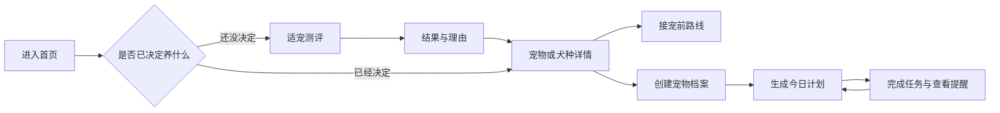

# 新手宠物养护助手项目计划

> 文档状态：规格基线已确认  
> 规划方式：SDD（Spec-Driven Development，规格驱动开发）  
> 产品范围：Web 前端 MVP  
> 原始需求：[project-doc.md](./project-doc.md)

## 1. 项目结论

本项目不以“宠物百科”为核心，而是帮助新手完成三个连续任务：先判断什么宠物适合自己，再获得当前阶段可执行的养护计划，最后持续记录并收到下一步提醒。

第一版界面覆盖狗、猫、鱼、乌龟和鹦鹉五类宠物；完整的个性化内容与规则优先覆盖狗和猫。鱼、乌龟和鹦鹉在 MVP 中提供选择介绍、基础路线和“内容建设中”的明确边界，后续按独立规则扩展。

## 2. 产品目标

### 2.1 核心目标

- 用户尚未养宠时，可以根据生活条件比较宠物类型和犬种。
- 用户决定或已经拥有宠物后，可以在三分钟内创建基本档案。
- 系统根据种类、年龄阶段和健康记录生成“今天做什么”。
- 每条健康建议都区分日常护理、建议咨询和紧急就医，避免替代专业诊断。

### 2.2 核心体验

### 2.3 成功标准

- 新用户无需注册即可完成测评、建档并看到计划。
- 测评结果解释推荐理由和主要代价，不只给出单一答案。
- 狗或猫档案创建完成后，Dashboard 至少生成一项日常任务、一项阶段建议和适用的健康提醒。
- 用户刷新页面后，宠物档案与任务完成状态仍然保留。
- 关键流程支持手机和桌面端，并满足键盘操作和基础无障碍要求。

## 3. MVP 范围

### 3.1 必须交付

1. 首页双入口：“帮我选择”和“我已经知道养什么”。
2. 五类宠物的选择卡片与基础对比信息。
3. 适宠测评、推荐结果以及猫狗对比。
4. 犬种筛选的可扩展框架和一组演示数据。
5. 狗、猫的新手成长路线图。
6. 狗、猫宠物档案创建流程。
7. 今日养护任务、完成状态和近期提醒。
8. 疫苗、驱虫、日常护理记录。
9. 健康异常快速查询和风险分级。
10. 接宠前用品 Checklist。
11. LocalStorage 本地持久化及数据版本迁移入口。

### 3.2 暂不交付

- 登录、云端同步和多人共享。
- 在线问诊、医疗诊断或药物剂量建议。
- 真实通知推送、短信和邮件提醒。
- 电商购买、商品推荐和广告。
- 社区、评论、内容投稿。
- 鱼、乌龟和鹦鹉的完整个性化规则引擎。

## 4. 实施路线

| 里程碑        | 目标                   | 主要产物                     | 完成门槛                         |
| ------------- | ---------------------- | ---------------------------- | -------------------------------- |
| M0 规格基线   | 固定范围和验收方式     | 需求、设计、任务文档         | 需求均有编号和验收场景           |
| M1 产品骨架   | 建立可导航的响应式网站 | 设计令牌、布局、首页、路由   | 五类入口在手机和桌面可用         |
| M2 选择助手   | 帮助用户先选宠物       | 测评、结果、对比、犬种筛选   | 结果可解释且可返回修改答案       |
| M3 新手指南   | 呈现接宠前与成长阶段   | 狗猫路线图、用品清单         | 用户能定位当前阶段和下一步       |
| M4 个性化计划 | 从档案生成养护任务     | 建档、规则引擎、Dashboard    | 狗猫档案能生成稳定、可测试的计划 |
| M5 健康与提醒 | 支持记录和风险提示     | 疫苗驱虫、提醒、健康查询     | 风险分级与免责声明完整           |
| M6 质量发布   | 达到可演示和部署标准   | 测试、无障碍、性能、部署配置 | 所有 P0 验收场景通过             |

## 5. SDD 执行规则

每个功能都按以下顺序推进：

1. 在需求规格中补充或修改需求编号和验收场景。
2. 在技术设计中记录数据结构、交互状态和重要决策。
3. 在任务清单中拆出可验证的实现任务，并关联需求编号。
4. 编写测试或验收脚本，再实现功能。
5. 通过单元、集成、端到端和内容安全检查后标记完成。

若需求发生变化，先更新规格，再修改代码。口头描述、页面实现和规格冲突时，以最近确认的规格为准。

## 6. 规格文档索引

- [需求规格](./docs/sdd/001-pet-companion-mvp/spec.md)：定义用户故事、功能边界、业务规则和验收场景。
- [技术设计](./docs/sdd/001-pet-companion-mvp/design.md)：定义技术栈、路由、领域模型、规则引擎和测试策略。
- [实施任务](./docs/sdd/001-pet-companion-mvp/tasks.md)：定义开发顺序、依赖、产物及验收门槛。

## 7. 当前技术决策

- 使用 Next.js、React 和 TypeScript 建设响应式前端。
- 使用 Tailwind CSS 管理视觉样式，建立温暖、干净、轻量的卡片式设计语言。
- 使用 Zustand 管理客户端交互状态，Zod 校验持久化数据。
- 使用版本化 LocalStorage 支持无登录体验，并为后续云端同步保留仓储接口。
- 将测评、成长阶段和养护任务定义为数据与规则，不把业务判断写死在页面组件中。
- 使用 Vitest、Testing Library 和 Playwright 覆盖规则、交互与核心路径。

## 8. 风险与控制

| 风险                         | 影响         | 控制方式                                   |
| ---------------------------- | ------------ | ------------------------------------------ |
| 五类宠物同时深入导致范围失控 | 延迟 MVP     | 狗猫完整实现，其余类型分阶段扩展           |
| 健康内容被误解为诊断         | 用户安全风险 | 风险分级、来源字段、免责声明和就医提示     |
| 规则互相冲突                 | 生成错误任务 | 明确优先级、冲突策略和规则单元测试         |
| 用户年龄或健康信息不完整     | 计划不可靠   | 显示假设、允许跳过并提示补充资料           |
| 本地数据被清除               | 记录丢失     | 明确本地保存边界，后续提供账号同步         |
| 测评结果显得绝对             | 误导选择     | 输出适合度、代价和理由，不宣称唯一正确答案 |

## 9. 下一决策点

规格基线已确认并进入 M1。产品名称暂用“PawGuide”；首批犬种演示数据在 M2 开始前确定，不阻塞工程骨架搭建。
